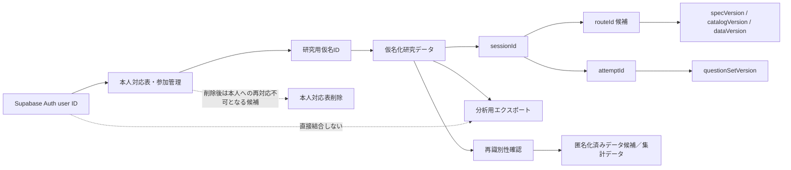
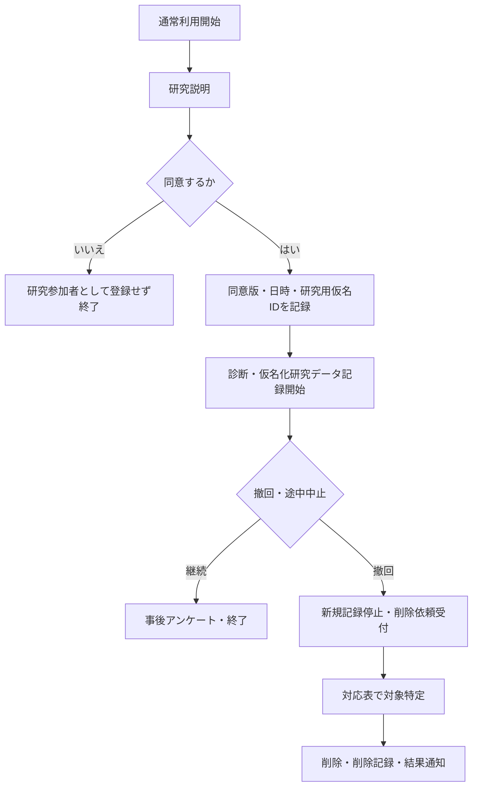

# 研究データ管理仕様

- 状態: **研究者判断反映済み・外部確認／具体値／実装契約待ち**。D-022、D-023、D-024、D-026、D-028、D-029に加え、D-030で初回予備試行に残る判断原則と実装分割境界を研究者本人が確定した。保存年数、正式起算日、個別承認証跡、参加者用環境、実保存先、担当者・role、backup最大残存期間および具体的実装は未確定・未実装
- 初回診断保存契約の決定日: 2026-09-05
- 研究用アクティブ学習時間の最小収集契約の決定日: 2026-10-21
- 評価用最小ログ・非収集境界の決定日: 2026-10-21
- 研究データ管理方針の可決済み報告日: 2026-11-11
- 残余判断原則・実装分割境界の研究者決定日: 2026-11-12
- 決定者: 北代櫂（研究者本人）
- 関連Issue: Linear `KAI-12`、`KAI-30`、`KAI-31`、後続`KAI-16`、`KAI-32`〜`KAI-35`、`KAI-39`、`KAI-45`、`KAI-46`
- 関連OQ: `OQ-009`（D-030までの研究者判断反映済み／外部確認・具体値・実装契約待ち）、`OQ-004`のDG-08、`OQ-005`の保存境界、`OQ-008`
- 作成基準: `main` `f9a5c0dbff374eaf8aae9a90ca9b111ff3839499`（2026-07-13）
- 重要: **§1.4の初回診断保存・復元契約はD-022に基づく確定仕様である。Task AはKAI-28で実装し、KAI-34までに指定非本番環境の合成検証を完了した。追加の指導教員承認不要という権限境界を、研究データ管理残余へ一般化しない。**
- 重要: **§16.6の表示名・KV・指定remote境界はD-023に基づく確定仕様である。KAI-34で監査済みprofiles・診断・KV撤去・Functionを指定remoteへ適用し、合成データ境界とcleanupを確認済みである。これは参加者データ収集や研究データ管理残余の許可を意味しない。**
- 重要: **D-024により当面はSupabase Freeプランを継続し、Freeに含まれないleaked-password protectionはKAI-35で有効化・検証しない。KAI-35は元受入条件未達とSecurity Advisor警告を維持して`Canceled`で終了した。実在参加者利用・予備試行・研究データ収集・本番化の前に認証セキュリティを再判断する。**
- 重要: **D-026により、教材・確認テスト・実践課題の研究用アクティブ学習時間について最小収集契約を確定した。保持期間、backupからの削除、本人対応表、研究者用access/exportの具体方式、撤回・削除期限、説明・同意および必要な学内確認はOQ-009/KAI-12の残余であり、D-026だけで参加者データ収集、募集または予備試行を開始しない。**
- 重要: **D-028により、KAI-39の評価票と分析に必要な最小ログ・非収集項目を研究者判断として確定した。評価票・分析方法・自由記述は2026-10-28に指導教員確認済み・変更指示なしである。保存・同意・保持・撤回等のOQ-009残余および具体的実装は未完了であり、D-028だけで評価ログ実装、参加者データ収集、募集または予備試行を開始しない。**
- 重要: **D-029により、初回予備試行では自由記述を収集せず、サーバー生成のランダムな研究用仮名ID、本人対応表の分離・暗号化・最小権限、研究者経路の分離、撤回削除台帳、backupの隔離・期限失効・復旧時再削除、連絡先分離、同意版、欠損区分、小セル非集計および版追跡を方針として確定した。**
- 重要: **研究者本人は2026-11-11に必要な判断主体によりD-029の方針が可決済みであると明示した。個別の氏名、承認日、規程名、議事録・資料名および証跡URLは未提示であり、取得済みとは扱わない。**
- 重要: **D-030は2026-11-12の研究者本人の判断である。指導教員・学内担当者の個別承認、学内規程の実内容または証跡を取得済みとは扱わない。30暦日は上位要件に反しない場合の既定候補であり、無条件の確定期限ではない。**
- 重要: **初回予備試行は研究参加専用導線とし、非同意者を研究参加者として登録せず研究ログを記録しない。D-023の合成データ専用remoteを実在参加者へ流用せず、参加者用環境を分離し、本人対応表を通常Data APIへ公開しない。**
- 重要: **初回予備試行ではS群・A群その他の未承認データ群を収集せず、D-026・D-028・D-029の最小ログだけを扱う。具体event/schemaはKAI-41完了後に固定し、欠損等を別コード、時刻をDB側UTC、eventを冪等かつ版付きとする。**
- 重要: OQ-009とKAI-12はD-030までの研究者判断を反映済みだが、外部確認・具体値・実装契約待ちである。同意UI、評価ログ、研究者用取得・削除・export、保持・撤回・削除の具体実装、参加者データ収集、予備試行は開始可能になっていない。
- 重要: D-022の権限確認は、学内規程上必要な手続または研究参加者の同意を免除しない。
- 重要: §11はD-029・D-030が直接カバーした項目だけを確定へ更新した。`部分確定`・`未確定`・`旧暫定採用`の残余を確定仕様として扱わない。

本文では、既存の正本文書から確認できる内容を`[確定事項]`、現行コードから確認した状態を`[コード存在確認済み]`、採用候補を`[提案]`、判断を要する内容を`[未確定]`として区別する。

[2026-10-07現在状態補足／KAI-48] 本文のTask A開始条件は契約確定時の境界であり、未実装の意味ではない。KAI-12/KAI-16は2026-10-01のLinear追記を現況として読み、旧PR #19 Draft・旧プロフィール未実装の履歴は保持する。募集時データ管理を含む残余と開始条件は [10-handover.md](../research/10-handover.md)、今回の実コード照合は [06-implementation-status.md](../research/06-implementation-status.md) を参照する。remoteを再検査・変更したものではない。

## 1. 文書の位置づけ

### 1.1 目的

KAI-12／OQ-009について、研究者本人と指導教員が次の事項を判断できる比較資料を提供する。AIが倫理・個人情報管理を最終決定するものではない。

### 1.2 決定者と承認手順

| 対象 | 決定・確認主体 | 完了の証跡 |
|---|---|---|
| 収集目的、収集項目、分析範囲、実装契約 | 研究者本人 | 判断表の記入、Decision Log、関連正本文書への反映 |
| 同意、撤回、仮名化、匿名化済みデータ候補への移行、保持、削除、権限、学内要件 | 研究者本人・指導教員 | 指導教員チェックリスト、必要な学内手続、Decision Log |
| schema、RLS、migration、同意UI、ログ、エクスポート | 承認済み仕様を受けた実装担当 | 分割Issue、PR、検証証跡 |

承認手順案は次のとおりとする。

1. 研究者本人が§11の判断表を記入する。
2. 指導教員が§12を確認し、学内規程・正式提出資料との不一致を指摘する。
3. 採用内容をDecision Log、`01-confirmed-decisions.md`、`02-open-questions.md`、`05-evaluation-plan.md`、`08-constraints.md`へ必要な範囲で反映する。
4. OQ-009の解消、KAI-12の完了可否、KAI-16の着手可否を研究者本人が判断する。
5. KAI-16等を分割し、実装・検証する。

#### 1.2.1 [D-030] 承認台帳

承認台帳は次の列を必須とする。空欄を承認済みとみなさず、未取得は`未取得`、該当しないと確認できた場合だけ`該当なし`と記録する。

| 判断項目 | 判断者 | 役割 | 判断日 | 規程・指示 | 証跡 | 承認範囲 | 再確認条件 | 状態 |
|---|---|---|---|---|---|---|---|---|
| D-030の8判断 | 北代櫂 | 研究者本人 | 2026-11-12 | 研究者本人の明示判断 | 本DecisionとKAI-12作業記録 | 判断原則・初回予備試行境界・実装分割 | 上位要件相違、具体値固定、KAI-41/45/46結果 | 研究者承認済み |
| 学内規程・手続要否 | 未取得 | 学内担当者等 | 未取得 | 未取得 | 未取得 | 保存・同意・撤回・削除・参加者利用 | 実根拠取得時 | 外部確認待ち |
| 指導教員の個別指定 | 未取得 | 指導教員 | 未取得 | 未取得 | 未取得 | 保存年数、起算日、削除、環境等 | 個別指示取得時 | 外部確認待ち |

個人名、役割、日付、規程名、議事録・資料名またはURLを取得した場合は、対象範囲と再確認条件を同時に記録する。研究者本人の承認を指導教員・学内担当者の承認へ一般化しない。

### 1.3 実装開始・予備試行開始ゲート

- [確定事項] D-022の初回診断保存・復元だけを扱う後続Task Aは、§1.4を実装契約として開始できる。参加者データや実在個人情報は使用せず、合成データ専用の非本番Supabase環境で検証する。
- [未確定] KAI-16のうち同意、研究データ収集、評価ログ、研究者用アクセス、保持・削除等を扱う実装開始には、対象項目ごとの別判断が必要である。
- [D-030] KAI-16配下の実装Issueは、学内・指導教員確認、保存年数・正式起算日、参加者環境・保存先・担当者・role・backup期限、KAI-41のID契約、および具体event/schema/export/delete契約を正本へ反映した後に作成・着手する。
- [未確定] 予備試行開始には、上記に加えて同意説明、撤回窓口、エクスポート確認、テストデータによる削除リハーサル、必要な学内手続の確認が必要である。
- [確定事項] 評価開始ゲートEG-08・EG-09が未達なら評価を開始しない。

### 1.4 [確定事項] 初回診断の最小保存・復元契約（D-022）

#### 1.4.1 画面遷移と失敗時挙動

1. 認証後、互換な完了済み診断を取得できない利用者は初回診断画面へ誘導する。
2. K群3項目すべてが妥当でなければ保存要求を受け付けず、Dashboardおよび学習画面へ遷移させない。
3. 保存要求の成功応答を受けた場合だけ、保存した回答をD-016の開始ノード判定とD-017のルート生成へ渡してDashboardへ遷移する。
4. 保存失敗時はDashboardへ遷移せず、利用者が入力した3回答を画面内stateに保持し、同じ内容を編集または再送できるようにする。失敗した要求を完了済みとして扱わない。
5. 明示的なログアウト後の再ログインでは、通常アプリAPIから本人の最新状態を取得し、互換かつ完了済みなら開始ノード判定とルート生成へ復元する。欠損・未知値・非互換版なら未完了として診断画面へ戻す。

`determineStartNode`が診断なし・欠損時に`html-000`を返すD-016の規則は、異常入力に対する純粋関数の防御的挙動として維持する。通常の認証後導線が診断ゲートを迂回してよいことは意味しない。

#### 1.4.2 保存レコード

初回実装では認証利用者ごとに最新1件だけをupsertする。`diagnosis-k/v1`は初回契約の識別子であり、診断項目や判定規則を変更する場合は新しい版を発行する。

| フィールド | 型・制約 | 更新規則 |
|---|---|---|
| `userId` | 認証済み利用者ID。通常APIではtokenから確定し、request bodyの他人IDを信用しない | 本人ごとの一意キー。研究用exportへ直接流用しない |
| `answers.programming_experience` | 必須。`yes` または `no` | 再回答時に上書き |
| `answers.rule_confidence` | 必須。`none`、`low`、`partial`、`confident`のいずれか | 再回答時に上書き |
| `answers.knowledge_concept` | 必須。`visual_only`、`unknown`、`somewhat`、`structure_style`のいずれか | 再回答時に上書き |
| `diagnosisVersion` | 必須の非空文字列。初回値は`diagnosis-k/v1` | 再回答時の版で上書き |
| `completedAt` | サーバーが付与するUTC ISO 8601日時 | その回答一式が正常保存された完了時刻で上書き |
| `updatedAt` | サーバーが付与するUTC ISO 8601日時 | 成功したupsertごとに更新。初回保存では`completedAt`と同時刻でよい |

- 保存する回答は上記K群3項目だけとする。S群、A群、旧重み付き`level`・`levelScore`、画面内の回答全文、変更前回答は初回実装で保存しない。
- 再回答は同じ利用者の最新レコードを置換し、回答履歴テーブルまたは版別の回答全文履歴を作らない。
- 空値、フィールド欠損、列挙外の値、余分な回答項目を、既定値への補完や黙示的変換で完了済みにしない。

#### 1.4.3 完了判定と版互換性

診断を完了済みとして再利用できる条件は、次のすべてを満たすことである。

- K群3項目がすべて存在し、§1.4.2の許容値に一致する。
- `diagnosisVersion`が現行版、または実装内で明示的に互換版としてallowlistされた版である。
- `completedAt`と`updatedAt`が妥当な日時である。

項目ID、許容値の意味、K群3項目の開始判定への対応を変えない文言修正、表示順変更、説明追加は互換変更として扱える。項目の追加・削除・改名、許容値または意味の変更、開始判定規則に影響する変更は非互換であり、新版を発行して再診断させる。未知の版は推測で互換扱いしない。

#### 1.4.4 通常アプリAPIと環境境界

- 通常アプリAPIのread/upsertは認証済み本人のレコードだけを対象とし、未認証要求または他人のレコードへの要求を拒否する。この本人境界はRLSとAPIの両方で検証する。
- 研究者用の横断取得、削除、exportは通常アプリAPIへ追加せず、別経路・別Issueで扱う。
- 開発、テスト、録画は合成データ専用の非本番Supabase projectで実行する。本番project、参加者データ、実在個人情報を使用しない。
- 後続Task Aの検証には、本人read/upsert成功、他人read/upsert拒否、未認証拒否、保存失敗時の回答保持と遷移拒否、再試行成功、再ログイン復元、欠損・未知値・非互換版の再診断、S群・A群および履歴の非保存を含める。

#### 1.4.5 権限確認と残存ゲート

研究者本人は2026-09-05に、KAI-12の本判断と§1.4に基づく後続実装について指導教員から判断を一任されたと明示した。この範囲に「指導教員確認待ち」を開始条件として残さない。ただし、学内規程上必要な手続、参加者同意、保持期間、撤回・削除、研究者用取得・削除・export、評価ログ、参加者データ収集、予備試行は別ゲートであり、解消済みと扱わない。

### 1.5 [D-029で方針確定／正式用語は要確認] 操作的用語

以下は本提案内で状態を区別するための操作的用語であり、法令上の「仮名加工情報」「匿名加工情報」等への該当性や学内規程上の正式用語を確定するものではない。採用と正式な表現は研究者本人・指導教員・学内規程の確認を要する。

#### 研究用仮名ID

- 認証ユーザーID、氏名、学籍番号、メールアドレス等の直接識別子を含まない研究用IDである。
- 推測困難なランダムIDとしてサーバー側で生成し、認証IDから単純hash等で直接導出しない。
- 本人対応表が存在する間は、対応表を用いて本人へ再対応可能である。
- 仮名化研究データの参加者キーとして用いる。具体的な生成・保存方式は実装待ちである。

#### 仮名化研究データ

- 直接識別子を研究ログから分離し、研究用仮名IDを用いたデータである。
- 本人対応表等の追加情報があれば本人へ再対応できる状態である。
- 対応表の保管、アクセス権限、保持、削除を研究ログと分離して管理する候補である。
- 「匿名化済み」と同一視しない。

#### 匿名化済みデータ候補

- 本人対応表を削除しただけで、自動的に匿名化済みとは断定しない。
- 少人数、属性の組合せ、時刻、自由記述、提出コード、学習経路等から再識別できないか確認する必要がある。
- 個人へ合理的に再対応できない状態かを、研究者本人・指導教員・学内規程に基づいて判断する。
- 判断前は`匿名化済みデータ候補`または`再識別性確認後のデータ`と表現し、法令上の「匿名加工情報」等に該当すると断定しない。

#### 集計データ

- 複数参加者の結果を集約したデータである。
- 少人数セル、極端値、自由記述引用等から再識別できる場合がある。
- 集計済みであることだけを理由に匿名と断定しない。
- 最小集計単位、少人数セルの抑制、引用方法は指導教員確認事項とする。
- D-030により、3〜5名の初回予備試行では保存期間中の個票・時系列ログを仮名化研究データとして扱い、匿名化済みと断定しない。公表はD-028の8項目の項目別全体集計と実行可能性記述に限定する。

## 2. 既に確定している制約

- [確定事項] 研究目的、収集情報、利用範囲を説明し、同意を得る。
- [確定事項] 参加は任意とし、不参加・途中中止による不利益を生じさせない。
- [確定事項] 氏名・学籍番号と学習ログを直接結び付けない。
- [確定事項] 本人対応表が必要なら、分析データと分離する。
- [確定事項] 研究目的外利用、無断転載、過剰収集を行わない。
- [確定事項] 小規模・短期評価から長期離脱率低下を断定しない。比較条件がなければ固定ルートへの優越性を主張しない。
- [確定事項] AIへ個人識別情報や生の自由記述を入力しない。
- [確定事項] D-022の初回診断保存について、通常アプリAPIでは認証済み本人だけが本人の診断状態を読み書きする。開発・テスト・録画には、合成データ専用の非本番Supabase環境だけを使用する。
- [研究者判断反映済み／外部確認・具体値・実装待ち] D-029・D-030により保存期間の決定原則、撤回可能境界、条件付き30暦日削除、削除対象台帳、研究者経路分離、backup取扱いは確定した。保存年数、正式起算日、上位要件、研究用途の実保存先および具体的実装は未確定である。

## 3. データ分類

表の保存先は候補であり、採用を意味しない。ただし、D-022で確定した初回診断の通常アプリAPIにおける本人アクセス境界と、開発・テスト・録画に用いる非本番環境の条件は§1.4に従う。`研究ID`は認証IDと別の研究用仮名IDを指す。本人対応表が存在する間、研究用仮名IDを用いる研究ログは仮名化研究データであり、本人へ再対応可能である。

| データ群 | 代表項目 | 取得元 | 収集目的 | 必須／任意 | 研究分析 | 直接識別性 | 機微性・再識別リスク | 保存先候補 | 保持判断 | 削除対象 | 出力 | 現行コード上の状態 | 根拠・未決事項 |
|---|---|---|---|---|---|---|---|---|---|---|---|---|---|
| 1. 認証・運用 | auth user ID、メール、表示名、セッション | Supabase Auth、登録画面 | ログイン、通常利用 | 通常利用に必須 | 使用しない | 高 | 高 | email・認証はAuth、表示名は`public.profiles` | 必要 | アカウント・運用記録 | 除外 | KAI-32で型付きprofilesを実装し、KAI-33でAuth metadataの表示名重複・KV経路を撤去、KAI-34で指定remoteへ適用済み | D-023の確定境界とKAI-32〜KAI-34の実装・合成検証に基づく |
| 2. 研究参加管理 | 研究用仮名ID、同意版、同意状態、同意・撤回日時 | 同意UI／研究者管理 | 適法・倫理的な参加管理 | 研究参加に必須 | 参加可否・欠損説明のみ | 対応表保持中は本人へ再対応可能 | 高 | 研究参加管理領域 | 必要 | 撤回・終了時 | 限定 | 未実装 | 同意版、再同意、撤回境界が未決 |
| 3. 診断 | K群回答、完了状態、再回答。S/A群は初回保存対象外 | 初期アンケート | 開始判定。S/A群の将来利用は未確定 | D-022によりK群3項目は初回診断・保存とも必須。S/A群の将来利用は未確定 | K群は開始判定に使用。S/A群の研究分析利用は未確定 | 直接識別子なし／対応表で再対応可能 | 属性組合せで再識別 | 仮名化研究データ／アプリ状態 | 必要 | 対象 | 必要 | 9項目UIと旧重み計算がある。KAI-27でK群3項目を開始判定・ルート生成・Dashboardへ接続し、KAI-28で本人単位保存・復元を実装、KAI-34で指定remoteの合成データ境界を確認済み | DG-08とK群3項目の初回保存契約はD-022で確定。S/A群の将来利用、年齢・職業は未確定。remote確認は参加者データ利用の許可を意味しない |
| 4. ルート入力スナップショット | diagnosis、completed/assumed/inProgress、quiz、error、reflection、catalog | route記録層 | 推薦の再現・監査 | 候補必須 | 利用候補 | 直接識別子なし／対応表で再対応可能 | 詳細履歴の組合せ | 仮名化研究データ | 必要 | 対象 | 必要 | KAI-26で純粋な`routeGenerator`を実装済み。KAI-27でK群・進捗・確認テストをメモリ内のルート入力としてDashboardへ接続済み。エラー・振り返り接続と永続化は未実装 | 入力スナップショットを全量保存するか参照IDで再構成するかは未確定 |
| 5. ルート結果・理由・版 | 全順序、上位3件、reasonCode、evidence、3版、generatedAt、routeId候補 | route記録層 | 説明可能性・再現性 | 候補必須 | 利用候補 | 直接識別子なし／対応表で再対応可能 | 行動推測 | 仮名化研究データ | 必要 | 対象 | 必要 | KAI-26でルート生成結果・理由・3版を実装済み。KAI-27で生成順の上位3件をDashboardへ表示済み。結果保存、`generatedAt`、`routeId`は未実装 | `routeId`、全順序・上位3件の保存範囲、`generatedAt`の保存形式は未確定 |
| 6. 学習進捗 | completed、inProgress、開始・完了イベント | アプリ | 学習状態、ルート入力 | 候補必須 | 補助指標候補 | 直接識別子なし／対応表で再対応可能 | 時系列で再識別 | アプリ状態／仮名化研究データ | 必要 | 対象 | 必要 | KAI-27でルートに影響するデモ初期値を除去し、完了・進行中状態をメモリ内のルート入力へ接続済み。永続化は未実装 | 実時間との区別、完了定義が未決 |
| 7. 確認テスト試行 | 得点、合否、試行回数、問題集合版 | Quiz | 形成評価、再受験、難易度・実行可能性の補助確認 | D-028の最小ログ | 利用 | 直接識別子なし／対応表で再対応可能 | 試行履歴・時刻 | 仮名化研究データ | 未確定 | 対象 | 必要 | 詳細モデルはメモリ内のみ | 生回答本文・誤答ID・具体的な時刻項目はKAI-12で判断。能力・学習効果の測定に使わない |
| 8. 実践課題・エラー | 承認済みerrorId、対応nodeId、発生・解消状態 | PracticeChallenge | 実践状態、復習、エラー・復習提示の体験確認 | D-028の最小ログ | 利用 | 直接識別子なし／対応表で再対応可能 | 時系列の組合せ | 仮名化研究データ | 未確定 | 対象 | 必要 | 簡易検出UIのみ。完了時にデータを親へ渡さない | 入力コード全文は非収集。具体的errorId・解除規則はKAI-41の残余 |
| 9. 振り返り | 選択式振り返りの正規ID | Reflection | ルート入力、振り返り体験の確認 | D-028の最小ログ | 利用 | 直接識別子なし／対応表で再対応可能 | 時系列の組合せ | 仮名化研究データ | 未確定 | 対象 | 必要 | 固定7概念・自由記述・仮値をメモリ保持 | 正規ID等はKAI-41の残余。自由記述は別行・別ゲートで、ルート入力へ使わない |
| 10. 事後評価票 | D-028の評価票8項目、完了状態、回答時刻 | アプリ／外部フォーム | 受容性・実行可能性評価 | Q1〜Q4必須、Q5〜Q8必須だが「該当なし」を許容 | 項目別に利用 | 対応表で再対応可能 | 少人数・回答時刻の組合せ | フォーム／仮名化研究データ | 必要 | 対象 | 必要 | 評価用事後アンケートなし | 質問・尺度・分析はD-028で研究者確定、2026-10-28に指導教員確認済み・変更指示なし。実装場所は未確定 |
| 11. 自由記述 | 初回予備試行では収集しない | 利用者入力 | 対象外 | 不収集 | 使用しない | 対象外 | 氏名、所属、第三者情報の混入リスク | 保存しない | 対象外 | 対象外 | 列を出さない | 振り返り欄候補は存在するが初回予備試行では入力・送信・保存しない | D-029。将来収集する場合は別Decisionが必要 |
| 12. 分析用派生 | 項目別集計、再受験数、完了数等 | エクスポート処理 | 分析・図表 | 採用指標のみ | 利用 | 集計方法次第 | 少人数セル・極端値による再識別 | 分析環境 | 必要 | 元データと別判断 | 必要 | 未実装 | 欠損・該当なし・途中中止・撤回・技術障害を別コードとし、属性別小セル分析を行わない。原データと派生値、派生定義、生成日時、対象commit・各版を追跡する。D-028/D-029 |
| 13. 本人対応表 | auth ID／連絡先と研究用仮名IDの対応 | 参加管理 | 撤回・連絡・削除 | 必須 | 不使用 | 最高 | 最高 | 研究ログから分離し暗号化 | 必要 | 削除台帳の対象 | 禁止 | 未実装 | D-029で分離・暗号化・最小権限・限定担当者を確定。実保存先、担当者、保持・削除時期は未記録 |
| 14. 監査・操作ログ | export、delete、権限変更、失敗、実行者・時刻・目的・対象版・結果 | 管理操作 | 説明責任、誤操作対応 | 研究者経路で必須 | 原則不使用 | 中 | 操作者情報 | 分離した管理ログ | 必要 | 対象 | 限定 | 未実装 | D-029で研究者操作記録を確定。記録範囲、閲覧者、保持期間の具体値は未記録 |

## 4. 評価用の最小収集・非収集境界

### 4.1 [確定事項] D-028の最小ログ

KAI-39の副次RQ評価と実行可能性確認に直接必要な項目を、次に限定する。これは論理データ契約であり、同意、保存、保持、権限および実装の開始許可ではない。

- 研究用仮名参加者ID、セッションID。
- 対象commit、ルート仕様版、教材版、問題集合版、評価票版。
- 診断結果から導出された開始ノード。
- 提示されたノード順と構造化された推薦理由。
- ノード開始・完了状態。
- 確認テストの得点、合否、試行回数。
- 承認済み実践エラーのID、対応nodeId、発生・解消状態。
- 選択式振り返りの正規ID。
- D-026に基づくセッション別アクティブ秒数。
- D-028の評価票回答。
- 中止・技術障害の分類。
- 上記イベントの順序、欠損、重複、撤回および版を判断するための必要最小限の時刻。

### 4.2 [確定事項] 初回予備試行の自由記述不収集

- D-029により、初回予備試行では評価票・振り返りを含む自由記述欄を設けず、入力・送信・保存・分析しない。
- 将来収集する場合は、目的、同意、保存、権限、保持、削除および分析を別Decisionで再確認する。初回予備試行の実装へ列や入力欄を追加しない。

### 4.3 [確定事項] 非収集項目

- 研究用export内のemail・表示名。
- 入力コード全文。
- キー入力内容、マウス軌跡、詳細クリック履歴。
- 閲覧ページ本文の複製。
- 承認された任意回答以外の無制限な文章。
- 学習に不要な属性。
- 音声・映像・インタビュー録音。
- 学習時間の参加者向け表示。

次のセキュリティ情報は研究目的の最小ログへ含めない。運用上の記録要否、保持およびアクセスはKAI-12の別判断とする。

- パスワード、access token、secret、IPアドレス、User-Agentの研究分析用複製。

### 4.4 [具体値・証跡・実装待ち] KAI-12へ残す事項

- 同意版、同意日時および撤回案内確認を記録し、実質変更時に再同意する方針は確定済みである。D-030により初回予備試行は研究参加専用導線とし、非同意者を研究参加者として登録せず研究ログを記録しない。研究外通常利用導線は必要性が確認されない限り初回対象外である。具体的な同意フロー、UIおよび保存schemaは未確定・未実装である。
- 研究用仮名IDをサーバー側の安全な乱数源で生成し、認証ID等から単純導出しない方針は確定済みである。具体的なID形式、生成ライブラリおよび保存契約は未確定・未実装である。
- 本人対応表を研究ログから分離し、暗号化、限定担当者、最小権限、再認証および操作記録を適用する方針は確定済みである。実保存先、担当者、保持・削除時期は未記録である。
- 保存期間と起算点は学内規程または指導教員の正式指定を優先する。明示規定がない場合は必要最短期間とし、「研究終了」または「最終成果提出の正式確定日」を起算候補とする。識別性の高い本人対応表等は短期化を優先して検討する。具体的な保存年数と正式な起算日は未記録である。
- 不可逆な匿名化・集約前までの撤回可能境界と、通常データ、研究ログ、複製、手元exportおよびbackupを削除台帳で管理する方針は確定済みである。本人確認後は研究ログ収集をただちに停止し、上位要件に反しない場合はliveデータ、本人対応表、複製および手元exportを30暦日以内に削除する。30暦日は条件付き既定候補であり、受付窓口、本人確認、完了通知および実手順は未記録・未実装である。
- 即時個別削除不能なbackupを隔離し、承認済み保存期限で失効させ、復旧時に削除台帳を再適用する方針は確定済みである。保管場所、承認済み期限および実手順は未記録・未実装である。
- 研究者用access/exportを通常利用者APIから分離し、最小権限、再認証、操作記録および対象版固定を適用する。初回予備試行では汎用ブラウザ管理画面を作らず限定server-side／backend経路を使い、内部分析版だけ研究用仮名IDを保持し、外部共有版では除外または再発番する。具体経路、role、形式および再発番方式は未確定・未実装である。
- 欠損、該当なし、途中中止、撤回および技術障害を別区分とする方針は確定済みである。具体的なコード値とschemaは未確定・未実装である。
- S群・A群その他の未承認データ群は初回予備試行から除外し、D-026・D-028・D-029の最小ログだけを扱う。具体的なevent/schema名はKAI-41完了後に固定する。欠損等は別コード、時刻はDB側UTC、eventは冪等かつ版付きとするが、具体値と実装方式は未確定・未実装である。
- 初回予備試行では自由記述を入力・送信・保存・分析しない。将来の試行で収集を検討する場合は、目的、同意、保存、権限、保持、削除および分析を別Decisionで再確認する。

### 4.5 自由記述・コード・学習時間のリスク

- 自由記述とコードには氏名、所属、URL、第三者情報が混入し得るため、初回予備試行では収集しない。将来収集する場合は別Decisionで注意文、入力制限、仮名化、アクセス分離、再識別性確認および引用前確認を定める。
- [確定事項] D-026により、`startedAt`と`submittedAt`の差ではなく、教材・確認テスト・実践課題のアクティブ秒数をセッション単位で収集する。最後の関連操作から3分までを計上し、その後停止する。離席、バックグラウンドタブ、ログアウト中および重複tab/device時間は除外する。
- [確定事項] 関連操作は活動の有無を判定するsignalとしてだけ扱い、入力文字列、クリック履歴、マウス軌跡、キー内容は保存しない。学習時間は研究用であり、学習者表示、進捗、推薦、報酬、合否または予備試行の成果指標へ用いない。
- [外部確認・具体値・実装待ち] 保持、backup、研究者用access/exportおよび撤回削除の原則はD-029・D-030で研究者確定済みである。保存年数・正式起算日・上位要件・backup保管場所と最大残存期間・具体的な経路とrole・実装方式・実手順はKAI-12で継続して確定する。

### 4.6 [確定事項] D-029の実装契約と未記録値

- 研究用仮名IDはサーバー側の安全な乱数源で生成する推測困難なIDとし、認証ID、email、表示名その他の直接識別子から導出しない。
- 本人対応表は研究ログと物理的または論理的に分離し、保存時・通信時の暗号化、限定担当者、最小権限、再認証および操作記録を適用する。実保存先と具体的方式は未確定であり、実装Issueで創作しない。
- 研究者用access/exportは通常利用者APIと分離する。操作ごとに再認証し、実行者、時刻、目的、対象データ版、対象件数および結果を監査記録する。
- exportはD-028の最小ログだけを対象とし、email、表示名、入力コード全文、自由記述、キー入力内容、詳細操作履歴を含めない。対象commit、ルート仕様版、教材版、問題集合版、評価票版および計測版を固定する。
- 撤回受付後は新規収集を停止し、本人対応表で対象を特定して、通常データ、研究ログ、複製、手元exportおよびbackupを削除対象台帳へ記録する。不可逆な匿名化・集約後は個別撤回不能となる境界を同意文書に明示する。
- 即時個別削除不能なbackupは通常利用から隔離し、承認済み保存期限で失効させる。復旧時は削除台帳を再適用してから利用を再開する。保存年数、起算日および削除実行日数は未記録である。
- 募集・日程調整用連絡先は研究ログと分離し、必要期間だけ保持する。同意版、同意日時および撤回案内確認を研究データ収集前に記録し、実質変更時は再同意する。
- 欠損、該当なし、途中中止、撤回および技術障害を別コードとして保持し、単一`null`へ統合しない。原データを上書きせず、派生値には派生定義、入力版および生成日時を付与する。
- 属性別小セル分析を行わず、D-028の8項目を項目別に全体集計する。自由記述原文は初回予備試行では存在せず、掲載しない。
- D-030により、D-023の合成データ専用remoteを実在参加者へ流用せず、参加者用環境を分離する。本人対応表を通常Data APIへ公開しない。project、保存先、担当者、roleおよびbackup最大残存期間は未確定である。
- 初回予備試行の3〜5名のデータは保存期間中、仮名化研究データとして管理する。本人対応表削除または集計だけを理由に匿名化済みとしない。

## 5. ID・分離設計

| ID | 役割 | 制約 |
|---|---|---|
| 認証ユーザーID | 通常利用・認証 | 分析データへ出さない |
| 研究用仮名ID | 仮名化研究データの参加者キー | サーバー側で推測困難なランダムIDを生成する。認証IDから単純導出せず、対応表保持中は本人へ再対応可能 |
| 本人対応表 | 研究用仮名IDと認証ID・連絡先等の対応。撤回・削除・連絡に利用 | 仮名化研究データと分離し、暗号化・最小権限・限定担当者・再認証・操作記録を適用する。実保存先と保持期間は未記録 |
| sessionId | 1回の利用・実施単位 | 再ログインと研究セッションの定義を分ける |
| attemptId | クイズ試行の一意キー | 全試行で一意、上書き禁止 |
| questionSetVersion | 問題・採点契約版 | 各試行に必須 |
| 3種のroute版 | 仕様・カタログ・データ版 | ルート結果に必須 |
| 分析用エクスポート | 分析・監査用の抽出データ | D-028の最小項目と固定版だけを含め、email、表示名、入力コード全文、自由記述および対応表を含めない。研究用仮名IDの扱いは実装前に固定する |
| 集計データ／匿名化済みデータ候補 | 複数参加者の集約値または対応表削除後のデータ候補 | 少人数・属性・時系列等の再識別性確認前に匿名化済みと断定しない |

### 5.1 `routeId`比較

| 案 | 長所 | 短所 | 適用条件 |
|---|---|---|---|
| A: opaqueな`routeId`を導入 | 再計算履歴、表示、選択、分析を安定して結合できる | ID生成・一意性・削除対象が増える | 複数ルート履歴を保存し、表示・選択まで追跡する場合 |
| B: 導入せず複合キー | データ項目が少ない | 研究ID、session、generatedAt等の複合条件が必要で結合ミスの余地 | 各参加者・各イベントで1結果だけ保存する場合 |

- [提案] ルート履歴と選択結果を分析する場合はAを推奨する。ただし研究者承認前に導入しない。
- [提案] IDは結果内容から導出せず、保存層でopaque IDを付与する。

## 6. 同意と撤回

### 6.1 [確定事項] 同意記録の最小項目

- `consentVersion`、`consentStatus`、`consentedAt`、撤回案内確認、`withdrawnAt`、研究用仮名ID。
- 同意前の通常運用ログを研究データへ遡及転用しない。
- 同意文書に実質的変更がある場合は再同意し、適用した版と日時を記録する。

### 6.2 未確定事項

- 初回予備試行は研究参加専用導線とし、非同意者を研究参加者として登録せず、研究ログを記録しない。研究外通常利用導線は必要性が確認されない限り初回対象外とする。将来、通常利用との併設が必要になった場合は別判断とする。
- 未成年者を対象とする可能性と追加同意の要否。
- 撤回受付窓口、本人確認方法、処理期限、通知方法。
- 本人対応表が存在する間は研究用仮名IDから対象ログを特定でき、撤回・個別削除を受け付けられる期間は対応表の保持期間と関係する。
- 本人対応表削除後は対象ログを特定できず、個別削除が不可能となる可能性がある。削除不能境界を同意説明と一致させる必要がある。
- 本人対応表削除後も、少人数・属性・時系列・自由記述・提出コード・学習経路等の再識別性を確認せず、匿名化済みと断定しない。
- 匿名化済みデータ候補または集計データとなった後の削除不能境界を設けるか。
- 予備試行と本実験で同じ同意版・データ仕様を用いるか。

撤回可能な最終時点はD-029により不可逆な匿名化・集約前とする。撤回受付窓口、本人確認方法、処理期限、通知方法、本人対応表の具体的保持・削除時期および再識別性確認手順は未記録である。

## 7. 保存先とアクセス権限

| 案 | 実装負荷 | セキュリティ | 再現性・分析 | 削除 | 権限・バックアップ | 誤収集・期間リスク |
|---|---|---|---|---|---|---|
| Supabaseへ保存 | 中〜高 | RLS・環境分離次第 | 高 | 条件設計次第 | 集中管理可能 | 現在のPRODUCTION環境へ誤投入する危険。別Issue必須 |
| 管理されたファイル／表 | 低〜中 | 保管場所と端末管理次第 | 中〜高 | 手動手順が必要 | 少人数では単純 | 版ずれ、複製、誤持出し |
| アプリ＋外部フォーム分離 | 中 | システムごとの権限が必要 | 結合設計が必要 | 複数箇所対応 | 分離に利点 | ID結合ミス、削除漏れ |
| 予備試行限定の一時取得 | 低〜中 | 対象・期間を狭められる | 本実験へそのまま一般化不可 | 比較的容易 | 手順依存 | 暫定運用の恒久化 |

- [提案] 予備試行は、対象者・期間・項目を限定し、現在のPRODUCTION表示のSupabaseへ参加者データを入れない案を優先比較する。
- [提案] 本実験では、研究ログを専用の非本番／研究用環境へ分離でき、RLS・削除・exportをテストできる場合にSupabase案を再評価する。
- Supabaseを採用しても、schema、RLS、migration、環境分離、バックアップ、削除確認は承認済みの別実装Issueで扱う。

### 7.1 権限候補

| 役割 | 認証データ | 対応表 | 仮名化研究データ | 自由記述・コード | 集計データ |
|---|---:|---:|---:|---:|---:|
| 研究者本人 | 運用上必要な範囲 | 限定担当者として再認証・操作記録を伴う最小権限 | 通常APIと分離した研究者経路で対象版を固定 | 初回予備試行では不収集 | 必要 |
| 指導教員 | 原則不要 | 原則不要 | 確認目的の必要範囲 | 再識別性確認後 | 必要範囲 |
| 実装担当 | テスト環境のみ | 不可 | 合成データのみ | 合成データのみ | 原則不要 |
| AIサービス | 不可 | 不可 | 原則不可 | 不可 | 再識別性確認後のデータのみ要判断 |

## 8. 保持・削除・バックアップ

具体年数と正式起算日は本文で確定しない。学内規程・指導教員指定を優先し、明示規定がない場合は必要最短期間とする。「研究終了」または「最終成果提出の正式確定日」を起算候補とし、識別性の高い本人対応表等は短期化を優先して検討する。

| 判断項目 | 候補 | 確認観点 |
|---|---|---|
| 起算点 | 最終参加日／研究終了日／論文提出日／審査・発表終了日 | 学内規程と説明文の一致 |
| 本人対応表 | 撤回対応が不要になった時点で先行削除／元データと同時削除 | 個別削除可能期間との関係 |
| 元データ | 分析確定後／審査終了後／学内規程の期間終了後 | 再分析・訂正と最小保持の均衡 |
| 集計データ／匿名化済みデータ候補 | 元データと同時／研究成果の検証に必要な範囲 | 少人数等を含め合理的に再対応できないか確認したか |
| バックアップ | 本体と同期削除／短い猶予後に削除 | 復元手順と削除完了日の説明 |

### 8.1 [D-029で方針確定／期限・実装待ち] 削除手順

1. 受付日時、対象研究、本人確認方法、処理担当を記録する。
2. 対応表で研究用仮名IDを特定する。
3. 本人確認後ただちに新規収集を停止する。
4. 参加管理、研究ログ、エクスポート、作業用複製、バックアップの対象を削除対象台帳へ列挙する。初回予備試行では自由記述・コード全文は収集しない。
5. 承認済み手順で削除し、件数・場所・実行者・日時を監査ログへ残す。
6. 個別削除不能な集計データまたは匿名化済みデータ候補がある場合、同意説明に記載した境界と一致し、再識別性確認を終えているか確認する。
7. 依頼者へ結果を通知する。

学内規程・指導教員指定に反しない場合、liveデータ、本人対応表、複製および手元exportは撤回確認から30暦日以内に削除する。30暦日は研究者承認済みの条件付き既定候補であり、上位要件が異なる場合は再判断する。即時個別削除不能なbackupは隔離し、承認済み保存期限で失効させ、復旧時に削除台帳を再適用する。誤取得時は収集停止、影響範囲特定、隔離・削除、指導教員・必要な学内窓口への報告要否判断、再発防止を行う。backup最大残存期間と実手順は未記録である。

## 9. ログ契約

初回予備試行はD-026・D-028・D-029の最小ログだけを扱い、S群・A群その他の未承認データ群を除外する。具体event/schemaはKAI-41完了後に固定する。すべてのイベントに、採用後の共通項目候補として`eventId`、`eventType`、`eventVersion`、研究用仮名ID、sessionId、`occurredAt`、`recordedAt`、関連版、欠損・警告を持たせる。時刻はDB側UTCで付与し、eventは冪等かつ版付きとする。欠損、該当なし、途中中止、撤回および技術障害を別コードで保持する。直接識別子は含めない。本人対応表が存在する間、これらは仮名化研究データとして扱う。

| イベント | 記録目的 | 最小項目候補 |
|---|---|---|
| 同意確定・撤回 | 収集可否の監査 | consentVersion、status、日時 |
| 診断完了・再回答 | 開始判定の再現 | 回答版、採用回答、matchedRuleId、完了状態 |
| ルート生成 | 推薦の再現・説明 | 入力snapshot、result、3版、generatedAt、routeId候補 |
| ノード開始・完了 | 進捗と所要時間 | nodeId、event、時刻、完了根拠 |
| 確認テスト提出・再受験 | 形成評価・復習 | attemptId/番号、quiz/node、版、得点、合否、誤答ID、時刻 |
| 実践課題提出 | 課題達成 | practiceId、達成状態、時刻、コード保存有無 |
| エラー検出・解消 | SRK・復習 | errorId、SRK、関連nodeId、検出/解消、時刻 |
| 振り返り確定 | つまずき入力 | nodeId、選択式nodeIds、時刻。初回予備試行では自由記述を含めない |
| 事後アンケート完了 | 評価回答の欠損管理 | questionnaireVersion、完了状態、回答時刻 |

### 9.1 ルート生成の保存境界

- [確定事項] 純粋な`RouteGenerationResult`に現在時刻を入れない。
- [提案] 保存層が結果受領時にUTC ISO 8601の`generatedAt`を1回付与し、後から上書きしない。
- [未確定] 入力スナップショットを全量保存するか、immutableな参照IDと版で再構成するか。
- [確定事項] 出力は順序付き全ルートを持ち、表示は既定で上位3件である。
- [未確定] 研究ログへ全順序を保存するか、表示上位3件だけを保存するか。再現性の観点では全順序、最小化の観点では上位3件＋結果hashが候補になる。
- [提案] 表示した上位3件と学習者が選択したノードは、UI表示と分析の対応を確認する場合のみ保存する。

### 9.2 [確定事項] KAI-39の評価ログ境界

- 評価票回答は実施版の項目ID、回答値、回答状態、評価票版を対応付ける。数値1〜5、「該当なし／体験していない」、欠損を区別する。具体的な版IDは実施版の確定時に記録する。
- 完遂者と途中中止者を区別し、中止理由は「本人希望」「体調」「技術障害」「その他」とする。途中中止者の任意短縮版は完遂者の8項目回答と同一集計に混在させない。
- 除外は対象条件不適合、同意未取得、参加撤回、評価データが成立しない技術障害、訂正不能な破損・重複に限定し、件数と理由を保持する。低い評価や否定的意見を除外理由にしない。
- D-028の最小ログと§4.3の非収集項目をKAI-16へ渡す。具体的なevent/schema名、時刻の粒度、保存先、RLS、export、保持、撤回・削除はKAI-12の承認後に別実装Issueで定める。
- 学習時間はD-026の品質・負担確認に限定し、成果指標、推薦、進捗、報酬、合否または参加者向け表示へ転用しない。

## 10. 分析用エクスポート

| 形式 | 長所 | 短所 | 用途候補 |
|---|---|---|---|
| JSON | ネスト構造、理由、snapshotを保持 | 表計算で扱いにくい | 監査・再現・アーカイブ |
| CSV | 集計しやすい | ネスト構造を複数表へ正規化する必要 | 定量分析 |
| 管理表 | 小規模試行で確認しやすい | 手作業・版ずれ | 予備試行限定 |

- [確定事項] 初回予備試行では汎用ブラウザ管理画面を作らず、限定server-side／backend経路で対象版を固定してexportする。
- [未確定] canonical exportの形式は、版付きJSONと派生CSV等を比較して別途固定する。CSV必須とはしない。
- [確定事項] 直接識別子と対応表をexportへ含めず、D-028の最小項目だけを対象とする。対象commit、ルート仕様版、教材版、問題集合版、評価票版、計測版、欠損値コード、派生定義、export日時、schema versionを保持する。
- [確定事項] 内部分析版だけ研究用仮名IDを保持し、外部共有版では除外または再発番する。具体的な再発番方式と形式は実装前に固定する。
- 初回予備試行では自由記述と提出コード全文を収集せず、exportへ列自体を出さない。
- 欠損、該当なし、途中中止、撤回、技術障害を空文字や単一`null`へ統合せず、具体的な正規コードは実装前に固定する。

## 11. 研究者判断表

DM-01〜DM-22は、D-022、D-026、D-028およびD-029で直接カバーされた範囲だけを確定へ更新する。D-029の方針は必要な判断主体により可決済みと研究者本人が2026-11-11に報告したが、個別の承認者氏名・承認日・証跡および具体値は未記録である。`部分確定`、`未確定`の残余をAIや実装担当が補完しない。

| ID | 判断項目 | [提案] 推奨案 | 代替案 | 理由・研究／実装影響・リスク | 研究者判断 | 指導教員確認 | 決定後の反映先 |
|---|---|---|---|---|---|---|---|
| DM-01 | 収集対象 | §4.1の最小セット | 詳細ログ追加 | 再現性と最小化の均衡 | **確定（D-028/D-029）:** D-028の最小ログ、同意・監査に必要な項目だけを収集する。生回答本文、提出コード全文、自由記述、詳細操作ログ、不要属性は収集しない。 | 方針可決済み報告。個別証跡未記録 | Decision、評価計画 |
| DM-02 | 自由記述 | 任意・分離・AI入力禁止 | 収集しない | 定性情報と再識別リスク | **確定（D-029）:** 初回予備試行では評価票・振り返りを含む自由記述を入力・送信・保存・分析しない。 | 方針可決済み報告。個別証跡未記録 | 評価票、ログ契約 |
| DM-03 | 提出コード | 初版は保存しない | snapshot保存 | 個人情報・著作物・容量リスク | **確定（D-028/D-029）:** 入力コード全文を保存・exportしない。承認済みerrorId等の具体契約はKAI-41の残余である。 | 方針可決済み報告。具体error契約未確定 | ログ契約 |
| DM-04 | 画面操作ログ | 収集しない | 限定イベントのみ | 過剰収集防止 | **確定（D-026/D-028）:** キー入力内容、マウス軌跡、詳細クリック履歴を保存しない。必要最小限の定義済みイベントだけを記録する。 | D-026/D-028範囲確定 | ログ契約 |
| DM-05 | 保存先 | 専用研究環境を優先比較 | 管理表／外部フォーム | 現PRODUCTIONへ誤投入しない | **部分確定:** D-022対象の開発・テスト・録画は合成データ専用の非本番Supabase環境を使用する。研究ログ、本番運用、本人対応表の保存先は未確定。 | D-022範囲は追加確認不要。残余は未確認 | KAI-16分割Issue |
| DM-06 | 研究用仮名ID | 推測困難なopaque ID | 別方式のランダムID | 直接識別子を分離し、安定結合と対応表による撤回対応を可能にする。対応表が存在する間は匿名化済みではない | **確定（D-029）:** サーバー側で推測困難なランダムIDを生成し、認証IDから単純導出しない。 | 方針可決済み報告。具体方式未実装 | ID契約 |
| DM-07 | 本人対応表 | 必要な場合のみ別保管し、目的・担当者・アクセス・保持・削除を定義 | 作成しない | 撤回対応と再識別リスクを研究ログから分離して管理する | **確定（D-029）:** 研究ログから分離し、暗号化・最小権限・限定担当者・再認証・操作記録で管理する。 | 方針可決済み報告。保存先・担当者未記録 | 管理手順 |
| DM-08 | 保持期間 | 本人対応表と仮名化研究データを分け、学内規程と研究工程から選択 | 同時削除／より短期・長期 | 撤回可能期間、再分析、最小保持の均衡。AIが期間を確定しない | **原則確定（D-029/D-030）:** 学内規程または指導教員の正式指定を優先する。明示規定がない場合は必要最短期間とし、研究終了または最終成果提出の正式確定日を起算候補とする。識別性の高いデータは短期化を優先して検討する。 | 具体年数・正式起算日・証跡未記録 | 同意・制約 |
| DM-09 | 撤回時削除 | 対応表保持中は特定可能な元データ・複製を削除 | 対応表削除後は個別削除不能境界 | 対応表削除だけで匿名化済みとせず、再識別性確認と同意説明の一致が必要 | **原則確定（D-029/D-030）:** 不可逆匿名化・集約前まで撤回可能とし、本人確認後ただちに収集停止する。上位要件に反しない場合、liveデータ、本人対応表、複製、手元exportは30暦日以内に削除し、backupは隔離・期限失効・復旧時再削除とする。 | 30暦日は条件付き候補。上位要件・実手順未確認 | 同意・削除手順 |
| DM-10 | アクセス権限 | 最小権限表 | 研究者単独管理 | 継続性と漏えいリスク | **確定（D-022/D-029）:** 通常APIは本人境界。研究者用access/exportは通常APIから分離し、最小権限、再認証、操作記録、対象版固定を必須とする。 | 具体経路・role未実装 | 運用手順 |
| DM-11 | バックアップ | 暗号化・期限同期 | バックアップなし | 可用性と削除漏れ | **方針確定（D-029）:** 削除台帳の対象とし、即時個別削除不能なbackupは隔離・期限失効・復旧時再削除とする。 | 保管場所・期限・実手順未記録 | 運用手順 |
| DM-12 | routeId | 履歴結合時のみ導入 | 複合キー | 追跡性とデータ増 | **未確定（旧暫定採用）:** routeIdの導入要否と生成規則はD-029で直接カバーされていない。 | 未記録 | route契約 |
| DM-13 | generatedAt | 保存層がUTCで付与 | 呼出側注入 | 純粋関数境界を維持 | **部分確定（D-017/D-029）:** 純粋なrouteGeneratorへ現在時刻を含めず、生成日時を版追跡対象とする。付与責任・形式の具体契約は未確定。 | 具体契約未記録 | KAI-16契約 |
| DM-14 | 全ルート保存 | snapshotと全順序を保存 | 上位3件のみ | 再現性と最小化 | **部分確定（D-028）:** 提示ノード順、構造化理由、各版は最小ログとする。入力snapshotと全順序の保存範囲は未確定。 | 残余未記録 | ログ契約 |
| DM-15 | 上位3件保存 | 実表示と選択を保存 | 保存しない | 受容性分析との対応 | **部分確定（D-028）:** 実際に提示したノード順は最小ログとする。選択イベントとrouteIdへの結合は未確定。 | 残余未記録 | ログ契約 |
| DM-16 | 全クイズ試行 | 得点・合否・誤答・版を全件 | 有効試行のみ | D-018追跡とデータ量 | **部分確定（D-028）:** 得点、合否、試行回数、問題集合版を最小ログとする。attemptId、誤答ID、時刻粒度および全試行保存方式は未確定。生回答本文は収集しない。 | 残余未記録 | quizログ |
| DM-17 | 学習時間 | アクティブ時間を最小収集し、計測限界を明記 | 収集しない／開始終了差 | 離席・重複・通信欠損 | **確定（D-026）:** 教材・確認テスト・実践課題のセッション別アクティブ秒数を収集し、総合学習時間は合計から導出する。idle閾値3分、表示中かつ最後に操作されたtab、単一device lease、30秒の冪等checkpoint、計測版、異常増分拒否を採用する。研究用の計測・品質・負担確認に限定し、成果指標、推薦、進捗、報酬、合否、学習者表示へ使わない。 | D-026全体の指導教員・学内確認は未確認 | KAI-16実装契約・分析計画 |
| DM-18 | export形式・研究用仮名ID | JSON＋派生CSV候補。内部版でID保持要否を判断し、外部共有版は除外または再発番 | 管理表のみ | 再現と分析の両立、外部共有時の再識別リスク | **部分確定（D-029/D-030）:** D-028最小項目と固定版だけを限定backend経路で出力し、email、表示名、入力コード全文、自由記述を含めない。内部分析版だけ研究用仮名IDを保持し、外部共有版は除外または再発番する。形式・再発番方式は未確定。 | 具体形式・再発番方式未記録 | export仕様 |
| DM-19 | 予備／本実験仕様 | 版を分け変更履歴を保持 | 同一仕様固定 | 予備試行後変更の追跡 | **確定（D-029）:** 原データと派生値を分け、対象commit、ルート仕様・教材・問題集合・評価票・計測の各版、派生定義、生成日時を追跡する。 | 方針可決済み報告。具体版IDは実施版確定時 | versioning |
| DM-20 | 同意しない通常利用 | 研究ログなしで許可する案 | 利用不可 | 任意参加・実装負荷 | **初回予備試行を確定（D-030）:** 研究参加専用導線とし、非同意者を研究参加者として登録せず研究ログを記録しない。研究外通常利用導線は必要性が確認されない限り初回対象外とする。 | 将来の通常利用併設は別判断 | 同意フロー |
| DM-21 | 匿名化済みデータ候補への移行条件 | 対応表削除に加えて再識別性確認と指導教員・学内規程確認を必須候補とする | 仮名化研究データのまま保持・削除 | 対応表削除だけを匿名化の十分条件にしない | **部分確定（D-029）:** 不可逆匿名化・集約前を撤回可能境界とし、対応表削除だけで匿名化済みとしない。具体的再識別性確認手順は未確定。 | 方針可決済み報告。確認手順未記録 | 同意・分析・管理手順 |
| DM-22 | 集計時の少人数セル | 最小集計単位と抑制規則を定義 | 個別判断 | 少人数、極端値、引用による再識別を防ぐ | **確定（D-029）:** 初回予備試行では属性別小セル分析を行わず、D-028の8項目を項目別に全体集計する。自由記述原文は掲載しない。 | 方針可決済み報告 | 分析計画・公表手順 |

## 12. 指導教員確認用チェックリスト

各項目を`Yes／No／要修正`で確認する。

- [ ] 研究目的に対して収集項目が過剰でない。
- [ ] 通常利用と研究参加が分離され、同意前に研究ログを記録しない。
- [ ] 同意しない場合と途中中止時に不利益を生じさせない。
- [ ] 直接識別子と研究用仮名IDの分離が妥当である。
- [ ] 本人対応表の目的、保管、アクセス、保持、削除が妥当である。
- [ ] 仮名化研究データを匿名化済みデータと同一視していない。
- [ ] 対応表削除後の再識別性確認と匿名化済みデータ候補への移行条件が妥当である。
- [ ] 撤回受付、本人確認、撤回可能期間、削除対象、削除不能境界の説明が妥当である。
- [ ] 保持期間・起算点・研究終了の定義が学内規程と一致する。
- [ ] アクセス権限、持出し、バックアップ、誤取得時対応が妥当である。
- [ ] 初回予備試行で自由記述・提出コード全文・不要属性を収集しない実装になっている。
- [ ] 予備試行と本実験の版・同意・変更管理が妥当である。
- [ ] ルート入力・結果・理由・版・generatedAt・routeIdの扱いが再現性に十分である。
- [ ] 確認テスト全試行と実践エラーの利用範囲が形成的評価の位置づけを逸脱しない。
- [ ] 事前・事後アンケートの質問、尺度、分析方法が研究質問と対応する。
- [ ] 集計データの少人数セル、極端値、引用で再識別を防げる。
- [ ] 同意説明で「匿名」と過大に表現せず、仮名化と削除不能境界を説明している。
- [ ] AIへ渡せるデータ範囲が明確である。
- [ ] 研究データ収集開始前に必要な学内手続が特定されている。

## 13. 承認後の後続Issue

### 13.1 KAI-16へ渡す実装契約候補

承認後、次を機械検証可能な契約へ変換する。

- 同意状態機械、同意版、同意なし・撤回後の書込拒否。
- 認証ID／研究用仮名ID／本人対応表の分離と権限。
- 承認されたデータ辞書、必須・任意、validation、event version。
- append-onlyのクイズ試行とルートイベント、`generatedAt`付与責任、routeId採否。
- retention、delete、backup、export、監査ログの実行手順とテスト。
- 合成データによるRLS、越権拒否、削除、export、復元の検証。
- D-028の評価票8項目、5件法、「該当なし」、必須・任意、実施時点、途中中止者の任意短縮版を区別できる回答契約。
- §4.1の最小ログだけを扱い、§4.3の非収集項目を保存・exportしないことを検証する契約。
- 完遂・途中中止・欠損・「該当なし」・撤回・除外・技術障害を区別し、除外数と理由を再現できる契約。

### 13.2 分割案

外部確認・具体値・KAI-41の契約を正本へ反映した後、KAI-16配下を次の独立Issueへ分割する。現時点ではIssueを作成・着手しない。

1. KAI-16-A: 同意ゲート、研究用仮名ID、本人対応表。KAI-40、KAI-45、KAI-12最終仕様に依存する。
2. KAI-16-B: 版付き研究event保存、欠損等の別コード、DB側UTC、冪等性。KAI-41とKAI-16-Aに依存する。
3. KAI-16-C: 研究者access、固定版export、監査ログ。KAI-16-A/Bと環境・role承認に依存する。
4. KAI-16-D: 撤回、削除台帳、backup再適用、結果通知。KAI-16-A〜Cと削除期限・backup期限の確定に依存する。
5. KAI-16-E: 分析用派生、版固定、D-028の項目別全体集計。KAI-16-B/Cに依存する。

routeGenerator保存接続は、routeGenerator自体の実装と混ぜず、純粋関数の入出力契約を保った別Issue候補とする。予備試行開始条件は、承認済み仕様、合成データでの通し検証、削除リハーサル、指導教員確認の完了とする。

## 14. 現行コードから確認した実装事実

以下は研究仕様ではない。

| 調査対象 | [コード存在確認済み] | 未接続・mock・注意 |
|---|---|---|
| 認証ID | Supabase Authの`data.user.id`を返し、アプリstateの`userId`に保持 | 分析用研究IDではない |
| 認証・表示名 | signupはemail/password/display name、signinはemail/passwordをEdge Functionへ送り、認証済み本人は`GET /display-name`と`PUT /display-name`を使用する。KAI-33 / PR #45では5項目用legacy `/profile`とfrontend helper/typeをrepositoryから撤去しmainへ反映済み | 表示名の正本は型付き`public.profiles.display_name`。age、occupation、pace、level、levelScoreは採用・移行しておらず、必要性と保存先は未確定 |
| 初期アンケート | 9項目、条件表示、旧重み付きscoreとlevel判定。KAI-28 / PR #34で未経験時もK群3項目を必須表示し、K群だけを保存する実装をmainへ反映した | S群・A群のUIと旧score表示は残るが診断APIへ送信・保存しない。KAI-34でK群保存・復元のremote合成検証済み |
| 進捗 | KAI-27で空の`completedNodeIds`・`assumedNodeIds`と`inProgressNodeId: null`から開始し、学習開始・完了をメモリ内のルート入力へ接続済み | 永続化なし。表示用の`currentNodeId`・`currentNodeName`は初期値を持つが、ルート生成入力とは区別する |
| クイズ | 詳細な`QuizAttemptResult`にID、番号、回答、版、得点、合否、誤答、時刻、model versionがある | Appの`quizAttemptHistory`にメモリ保持し、Quizへ渡す。入力欄stateと確定済み試行履歴を区別する。再ログイン時は初期化、永続化なし |
| 実践課題 | 入力コード、簡易SRK検出、正規errorIdから復習先を表示 | 完了callbackはデータを渡さず、提出コード・error・解消履歴を保存しない |
| 振り返り | node、固定7概念、自由記述、日付、recommendationsをメモリ保持 | `quickTestResult=true`は仮値。概念が正規nodeIdでなく、永続化なし |
| 事後アンケート | 該当機能を確認できない | 未実装 |
| ルート生成 | KAI-26で純粋なrouteGenerator、KAI-27でK群3項目・進捗・確認テストとDashboard上位3件表示を接続済み。KAI-28 / PR #34で認証後に保存済みK群を復元して同じ開始判定・ルート生成へ渡す実装をmainへ反映・再検証した | `generatedAt`、routeId、診断以外の学習履歴保存は未実装。診断・通常運用表示名のremote API境界はKAI-34で合成検証済み。参加者の通常フロー全体は未評価 |
| Supabase永続化 | KAI-28 / PR #34の`public.user_diagnoses`、KAI-32 / PR #42の`public.profiles`、KAI-33 / PR #45のKV helper・legacy保存経路撤去をmainへ反映し、KAI-34で指定remoteへ適用した。本人限定RLS・GRANT・API認証、失敗境界、cleanupを合成A/Bで検証済み | 研究者用取得・削除・export、診断履歴、進捗、試行、課題、エラー、振り返り、ルート、同意、評価ログは対象外・未実装。remote検証結果を参加者データ利用へ一般化しない |

### 14.1 調査した主なコード箇所

- 認証・ユーザーID・表示名: `src/components/Auth.tsx`、`src/utils/auth.ts`、`supabase/functions/_shared/profile.ts`、`supabase/functions/make-server-f3d88633/index.ts`
- 診断項目・旧スコア・K群保存成功ゲート: `src/data/questionConfig.ts`、`src/components/SignupSurvey.tsx`、`src/App.tsx`
- 進捗・固定値・メモリ状態: `src/App.tsx`、`src/components/Dashboard.tsx`
- クイズの版・採点・全試行モデル: `src/features/quiz/types.ts`、`src/features/quiz/grading.ts`、`src/features/quiz/attempts.ts`、`src/components/Quiz.tsx`
- 実践課題コード・簡易エラー検出・SRK・復習先: `src/components/PracticeChallenge.tsx`、`src/data/errorMappings.ts`
- 振り返りの選択式項目・自由記述・仮値: `src/components/LearningReflectionForm.tsx`、`src/components/LearningReflections.tsx`
- 事後アンケート: `src/`配下を名称・文言で検索したが、評価用事後アンケートに該当するコンポーネントまたはデータ契約を確認できなかった。

### 14.2 repository/local候補と指定remoteの現在差

- repository/main: KAI-33 / PR #45のmerge commit `f7bf8c86ebae8e23c7c8ddb9aa9fbb43bf8b1246`により、legacy `/profile`、frontendの`saveProfile` / `ProfileData`、KV helperを撤去済みである。表示名は型付き`public.profiles.display_name`、診断K群3項目は`public.user_diagnoses`を使用する。
- 指定remote: KAI-34で`public.profiles`と`public.user_diagnoses`を適用し、`public.kv_store_f3d88633`を撤去した。Edge Functionはversion 5へ更新し、表示名・診断の本人成功、他人・未認証拒否、失敗境界、再ログイン復元を合成データだけで確認した。
- cleanup: 作成した合成Auth user、profiles、diagnosesは対象集合0件で、独立確認でも両public tableは0件だった。実在個人情報・研究参加者データは使用していない。
- 境界: `profile:{id}`の5項目を採用・移行していない。KAI-34は合成データ専用非本番環境の技術検証であり、保持、撤回・削除要求運用、同意、評価ログ、研究者access/export、参加者利用の判断には一般化しない。

## 15. 未決事項と対象外の既知問題

- D-022の初回診断保存・復元契約は確定済みであり、この範囲の後続Task Aに追加の指導教員承認は不要である。
- OQ-009とKAI-12はD-030までの研究者判断反映済み／外部確認・具体値・実装契約待ちである。保存年数、正式起算日、個別承認証跡、参加者用環境、実保存先、担当者・role、backup期限、研究者用access/exportおよび評価ログの具体実装は残り、KAI-12はIn Reviewのまま維持する。
- 学内要件と正式提出資料との整合、参加者データ収集・予備試行の開始可否は未確認である。
- [2026-11-11更新] D-029により保持・撤回、本人対応表、研究者用access/export、backup、同意版、欠損区分、版管理の方針を確定し、初回予備試行の自由記述を不収集とした。募集経路、保存年数、起算日、削除日数、個別証跡、実保存先および具体実装は残る。
- [2026-11-12更新] D-030により承認台帳、必要最短期間・正式終了日基準、条件付き30暦日削除、参加者環境分離、研究参加専用導線、限定backend export、仮名化管理、S群・A群不収集およびDB側UTC・冪等・版付きeventの原則を研究者確定した。指導教員・学内確認、具体年数、参加者環境、担当者・role、backup期限および具体契約は残る。
- KAI-39の契約確定と指導教員確認は、KAI-16の実装、参加者データ収集、募集または予備試行の許可ではない。KAI-12/KAI-40/KAI-45/KAI-46/KAI-37の各ゲートを維持する。
- 本文同期ではDB、RLS、migration、Edge Function、API、同意UI、保存処理、評価ログ、CSV出力、アプリコードを変更しない。

## 16. [履歴] KAI-30 KV依存調査（2026-09-06）

この節はKAI-30当時の履歴記録であり、fresh local Supabaseで通常entryのsignupが失敗する原因と、後続判断の選択肢を整理したものである。現行状態は§14を参照する。`[コード存在確認済み]`と`[確認済み事実]`は採用仕様を意味しない。比較中の推奨は`[提案]`であり、研究者判断、schema変更、remote変更を行っていない。

### 16.1 調査範囲と根拠

- 対象Issue: Linear `KAI-30`。目的、対象外、受入条件、検証方法が定義済みである。
- 研究上の境界: D-019、D-022、OQ-009、Linear `KAI-12`。
- 実装根拠: `src/components/Auth.tsx`、`src/utils/auth.ts`、`supabase/functions/make-server-f3d88633/index.ts`、`supabase/functions/make-server-f3d88633/kv_store.ts`、`supabase/migrations/`。
- local再現根拠: §14と`docs/research/06-implementation-status.md`に記録されたKAI-29のfresh local検証。
- remote差分根拠: 2026-09-06の現行タスクに添付された事前読取証跡。今回の調査ではremoteへ再接続せず、行取得、SQL実行、migration適用、Function deploy、project設定変更を行っていない。
- Supabase公式参照: [User Management](https://supabase.com/docs/guides/auth/managing-user-data)、[Users](https://supabase.com/docs/guides/auth/users)、[Row Level Security](https://supabase.com/docs/guides/database/postgres/row-level-security)、[Securing your data](https://supabase.com/docs/guides/database/secure-data)。公式文書は、`auth` schemaがData APIへ公開されないこと、APIで扱うプロフィールは`auth.users`の主キーを参照する公開tableとRLS・最小GRANTで保護できること、`user_metadata`を認可判断に使えないこと、service roleがRLSを迂回することを確認するために参照した。

### 16.2 現行の保存・取得経路

| 経路 | 入力・保存項目 | 保存先・key | 呼出元と利用箇所 | エラー時挙動 | KV必要性 |
|---|---|---|---|---|---|
| `POST /signup` | `email`、`password`、`name`。Authにはemail/passwordと`user_metadata.name`、KVには`email`、`name`、`createdAt` | Supabase Authと`user:{auth user id}` | `Auth.handleSubmit` → `signup`。成功レスポンスの`name`は現在の登録画面では後続利用せず、登録後はログイン画面へ戻る | Auth user作成後の`kv.set`失敗を外側のcatchがHTTP 500へ変換する。Auth userを補償削除しないため、失敗後もAuth userだけ残り得る | **必須**。KV失敗でsignup全体を失敗扱いにする |
| `POST /signin` | `email`、`password`。KVから表示名候補を取得 | `user:{auth user id}`をread | `Auth.handleSubmit` → `signin` → `App.handleSigninSuccess`。返却`name`は診断、Dashboard等の表示に使う | `kv.get`だけを内側のcatchで握り、`user_metadata.name`、さらに`"ユーザー"`へフォールバックする。認証成功自体は維持する | **任意**。KVなしでも成立する |
| `POST /profile` | `age`、`occupation`、`pace`、`level`、`levelScore`、サーバー付与`updatedAt` | `profile:{auth user id}` | `saveProfile`は定義されるが`src/`に呼出箇所がない。読取APIもない | Bearer token欠損・不正は401。KV保存失敗はHTTP 500 | エンドポイント内では**必須**だが、現行フロント導線では未接続 |

[コード存在確認済み] `kv_store.ts`は`key`と任意の`unknown`値をservice roleで操作する汎用helperであり、`set`、`get`以外の`del`、`mset`、`mget`、`mdel`、`getByPrefix`に現行呼出元はない。全操作がservice role clientを使うため、table側RLSがあっても所有者境界はhelperでは強制されない。現在のkeyにはauth user IDが文字列として埋め込まれるが、列としての外部キー、所有者制約、値の型制約、削除連携はない。

### 16.3 重複と現行の正本不在

| 項目 | Auth | KV | 現行の不整合 |
|---|---|---|---|
| email | Auth identityのemail | `user:{id}.email` | 同値を重複保存する。更新・削除同期規則がない |
| 表示名 | `user_metadata.name` | `user:{id}.name` | signupで二重保存し、signinはKVを優先する。更新API、正規化、最大長、変更可否、削除規則がないため、どちらが正本か確定していない |
| 作成日時 | Authの管理時刻 | `user:{id}.createdAt` | 用途が定義されず、Auth側時刻との関係も未定義 |
| profile 5項目 | なし | `profile:{id}` | 型はフロントのTypeScript interfaceだけで、API入力validation、DB列制約、読取経路、現行UI接続がない |

D-023により、`user_metadata.name`は通常の表示名読取元にせず、RLS、権限、本人所有判定にも使用しない。表示名は研究分析に使わない通常運用データ、型付き`public.profiles.display_name`を唯一の正本とする。emailはSupabase Authを正本とし、KVへ複製しない。

### 16.4 KAI-30調査時点のfresh localと指定remote候補の差

| 対象 | migration・schemaの確認結果 | 通常entryへの影響 |
|---|---|---|
| fresh local | `supabase/migrations/`にあるのは`20260905104859_create_user_diagnoses.sql`だけであり、KV table作成migrationはない | Auth user作成までは成功するが、直後の`kv.set`がrelation不存在で失敗しHTTP 500になる。Auth userだけ残り得るため、同じemailで単純再試行すると既登録エラーになり得る |
| 指定remote候補 `znfwkrhquegvlcmugkoe` | 現行タスクの2026-09-06事前読取証跡では、remote migration履歴に`20251204051132_create_kv_table_f3d88633`があり、`public.kv_store_f3d88633`が存在する一方、`user_diagnoses`は未適用 | 現行signupのKV前提は満たすが、リポジトリから再構築できない。逆にD-022の診断migrationはremoteへ反映されておらず、localとremoteが相互に異なるschemaを持つ |

[履歴] この節はKAI-30調査時点の差分である。その後KAI-34で指定remoteを再確認し、明示許可後に型付きschemaとFunctionを適用してKVを撤去した。現在状態は§14.2と`docs/operations/kai-34-remote-application-plan.md`を参照する。

### 16.5 選択肢比較

| 観点 | A: KVをmigration管理して継続 | B: Auth metadataだけへ限定 | C: 型付き`public.profiles`へ置換 | D: local fixtureだけ追加 |
|---|---|---|---|---|
| 変更概要 | 現行KV table、必要なGRANT・RLS・indexを正式migrationへ取り込む | `user:{id}`のread/writeを削除し、表示名は`user_metadata.name`だけから取得する | `auth.users(id)`を参照する本人1行のtableへ、承認済みの表示名だけを型・制約付きで保存する | local検証時だけKV tableを作り、アプリ実装とremoteは維持する |
| 型安全性 | `jsonb value`のままで低い。key prefix別validatorを別途実装しない限りDB契約にならない | metadataはJSONでありDB列制約は弱い。アプリvalidatorは必要 | 列型、NOT NULL/任意、CHECK、長さ、時刻、FKをmigrationで固定でき最も高い | 本番相当契約は改善しない |
| RLS・認可 | key文字列から所有者を解釈するpolicyが複雑。現行service role helperはRLSを迂回する | Auth API経由。metadataを認可判断には使わない。プロフィール用Data API policyは不要 | `id = auth.uid()`の本人限定SELECT/INSERT/UPDATE、必要最小GRANTを検証できる。UPDATEにはSELECT、`USING`と`WITH CHECK`が必要 | fixtureをpolicyなしdefault denyにしても、service role経路の所有者境界は改善しない |
| service role範囲 | signup、signin、profileのKV操作で継続 | signupのadmin user作成には残るが、表示名のKV操作からは除去できる | Auth admin作成以外を利用者JWT＋RLSへ移せる候補。作成trigger方式はsignup阻害リスクを別途検証する | 現行範囲のまま |
| PII重複 | email・表示名のAuth/KV重複を維持 | email・表示名ともAuth内の1か所へ寄せられる | emailはAuthだけ、表示名はprofilesだけとすれば重複を解消できる。移行期間の二重書込は禁止候補 | 重複を維持 |
| 削除・保持 | auth user削除とのFK連携がなく、prefix行の削除漏れ対策が必要 | Auth user削除へ集約できるが、JWT失効境界とAuthの運用規則は別途必要 | `auth.users(id) on delete cascade`候補で連携できる。保持・撤回規則自体は研究判断待ち | remoteの削除漏れ問題を解消しない |
| local/remote再現性 | migration化すれば一致させやすいが、remote既存tableとの差分吸収migrationが必要 | schema依存が減り、fresh local signupを最小変更で再現しやすい | migrationとRLSテストで一致を機械検証できる。remote既存KVからの移行計画が必要 | local signupだけ通せるが、remote固有前提を隠し環境差を固定する |
| rollback | Edge Functionを旧版へ戻し、必要データ退避後に追加migrationを逆向きmigrationで撤回。既存remote object衝突に注意 | 旧Functionへ戻すにはKV tableが必要。切替前にmetadata欠損を検査する | Functionを旧版へ戻し、必要データ退避後にprofilesを逆向きmigrationで撤回。移行中の正本を一意に保つ | fixture削除だけで戻せる |
| D-022/OQ-009境界 | `user_diagnoses`とは分離できるが、KVを診断や進捗へ拡張しない | D-022の診断契約を変更しない。表示名の用途・規則は未確定 | D-022の本人限定RLSパターンを参考にできるが、表示名の項目契約は別判断。診断・進捗・研究ログをprofilesへ混在させない | D-022を変更しないが、OQ-009判断を先送りする |
| 主な利点 | 現行コード変更が小さい | 最小のデータ重複とschema。signinの既存fallbackを正規経路にできる | 型、安全境界、削除連携、再現性、将来の本人編集を明示しやすい | 最小・一時的で、remoteへ触れない |
| 主な欠点 | 汎用JSONB、service role、所有者不明key、PII重複を正式化する | 表示名の型・制約が弱く、Auth metadataの更新権限と正規化を別途管理する | 実装量と移行設計が増える。表示名の必要性・規則を先に決める必要がある | 技術的負債と環境差を残し、正式な再現方法にならない |
| 研究者判断 | KVを通常運用の正式保存先にする判断が必要 | 表示名をAuth内の通常運用データとする判断が必要 | 表示名の目的、正本、型、更新・削除規則の判断が必要 | fixtureが合成local限定であることは決められるが、正式方針の代替にはできない |

### 16.6 [確定事項] D-023の表示名・KV・remote契約

#### 表示名の目的と正本

- 表示名は認証後の画面で継続利用する通常運用データとし、研究分析、評価指標、研究用export、研究用仮名ID、参加者識別には使用しない。実名を要求せずニックネームを許可する。
- 表示名の唯一の正本は型付き`public.profiles.display_name`、emailの正本はSupabase Authとする。Auth `user_metadata.name`とKVを通常の表示名読取元にしない。
- `user_metadata`を認可、RLS、本人所有判定に使用しない。

#### 型・更新・削除契約

- `display_name`は必須で、前後空白をtrimした後1〜50文字とする。空文字、改行、制御文字を拒否する。
- 日本語を含むUnicodeを許可し、実名表記に限定する狭い文字種allowlistは設けない。認証済み本人による変更を許可する。
- 欠損時の`「ユーザー」`はUIだけのfallbackとしDBへ保存しない。
- `profiles.id`は`auth.users(id)`主キーを参照し、Auth user削除時に連動削除する。`created_at`と`updated_at`はDB側時刻を使う。
- signupはAuth userと必須profileが成立した場合だけ完了扱いとする。具体方式はKAI-32で決め、失敗時に孤立Auth userまたは利用可能な不完全accountを残さない。

#### KV廃止

- `user:{id}`のemail、name、createdAt重複を廃止する。
- `profile:{id}`のage、occupation、pace、level、levelScoreは自動移行せず、コードから採用済み仕様と推測しない。必要なら別Decisionで再設計する。
- remote削除前に行数、利用箇所、rollback条件を再確認する。データが存在する場合は自動移行・削除を行わず停止する。

#### 指定remoteと承認境界

- project ref `znfwkrhquegvlcmugkoe`を合成データ専用の非本番remote検証環境として正式指定し、実在個人情報・研究参加者データを禁止する。
- Git管理、local/CI検証、Draft PR監査、対象変更への明示許可を満たす変更だけmigration適用・Edge Function deployを許可する。RLSとGRANTは別レイヤーとして設計・検証する。
- deploy前後確認とrollbackは`docs/operations/supabase-setup.md`を正とする。service roleまたはsecret keyをfrontendへ公開しない。
- D-023の決定者は研究者本人である。研究者本人は、D-023とその確定契約に基づくKAI-32〜KAI-35の着手判断を指導教員から委任されていると明示しており、この範囲で追加の指導教員承認を開始条件としない。
- この委任は、指導教員がD-023の技術内容を個別に確認・承認済みであることや、remote変更への包括許可を意味しない。対象project ref、変更内容、適用版ごとの研究者本人の明示許可は引き続き必須である。
- 実在参加者データ、研究データ収集、予備試行、同意、保持、撤回・削除要求運用、本人対応表、研究者用access/export、評価ログ、学内手続、KAI-12/OQ-009の残余、KAI-16は委任範囲外であり、本判断では開始可能にならない。

### 16.7 後続Issue

1. **KAI-32 型付きprofilesと表示名save/loadをlocal実装する**: migration、型、validation、本人限定RLS、明示GRANT、signup/signin/read/update、Auth削除連携、KV name/email依存除去をlocalで実装する。remote適用は対象外。
2. **KAI-33 KV廃止とremote schema差を解消する**: PR #45と完了証跡PR #46はmainへ反映・再検証済みで、Linear KAI-33はDoneである。KAI-33自体ではremoteを変更せず、後続KAI-34の独立許可で適用した。
3. **KAI-34 指定remoteへ監査済み変更を適用して統合検証する**: 監査済み版の指定remote適用、合成A/B・未認証・失敗境界、cleanup、Advisor取得、PR #47のmain反映、main両検証、Linear完了証跡を完了しDoneとした。
4. **KAI-35 Supabase Auth leaked-password protectionを有効化・検証する**: D-024のFreeプラン継続判断により有効化・検証は未実施で、元受入条件とSecurity Advisor警告は未解消のままである。PR #49のmain反映とmain `Check`成功後、研究者本人の明示判断により`Done`ではなく`Canceled`として終了した。

進捗snapshot、クイズ試行、実践課題、振り返り、評価event log、同意、研究者exportはこの分割へ含めず、それぞれOQ-009の確定後に別Issueとする。

### 16.8 KAI-30完了時点の非変更・未確認事項

- schema、migration、Edge Function、frontend、remote Supabaseを変更していない。
- remoteの行データ、Auth user、Storage、ログ、secret/service-role keyを取得・使用していない。
- fresh local再実行は行わず、KAI-29で記録済みの合成データ検証と現行migration・コードの静的突合を使用した。
- 指定remoteの2026-09-06事前読取結果は今回再確認していない。後続remote作業前にproject ref、環境用途、migration履歴、table/RLS/GRANT/index、Edge Function versionとJWT検証方法を再確認する。
- 文書のみの調査であり、アプリ挙動を変更していないため、アプリのtypecheck、lint、test、buildは実行対象外とする。文書差分には`git diff --check`を実行する。
